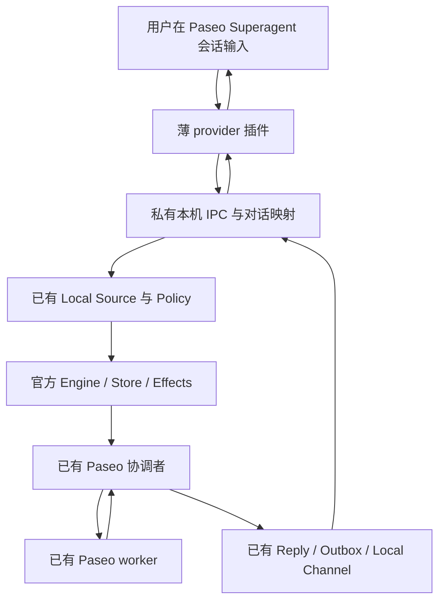

# 在 Paseo 窗口直接与 Superagent 对话

日期：2026-11-06。状态：设计提案；本文没有实现或实测新的对话入口。

基线：本 fork 的 `31d62b7`，已有本地 CLI、Paseo 协调者/worker、工具桥和 transcript 读取。以 [最小适配计划](../plans/2026-11-05-superagent-with-paseo-local.md) 和 [当前状态](../../../PASEO.md) 为基础；不重新启用早期长期设计中的独立宿主、交付接受状态机等范围。

## 1. 用户目标与推荐结论

用户在一个 Paseo 会话中直接输入自然语言，发起工作、回答执行者的问题、询问状态并收到成果。日常使用无需手工执行 submit/replies，也无需提供 request、thread 或 ticket ID。继续以官方 DSH prototype 为基础，增加消息入口及输出适配，沿用现有执行入口。

推荐增加一个名为 **Superagent** 的 Paseo provider 插件。它只负责收发和展示，不调用模型，也不承载另一套协调逻辑。用户打开它创建的会话；现有 Paseo 协调者和 worker 会话继续负责判断、派工和执行。

这在技术上增加一个无模型的会话入口。用户仍只需要一个常用窗口，后台始终只有原有协调者负责路由。原协调者和 worker 可以在 Paseo 中查看，但向它们直接输入不会自动成为经过本地 Source/Policy 接收的请求。

首版按当前个人本机场景设计：一个 Superagent 状态目录对应一个持续的对话记录；工作目标仍由该状态目录的现有 deployment/executor 配置决定。Paseo 窗口的 cwd 不重新选择仓库或改变执行授权。多项目入口选择、从任意普通 agent 转为 Superagent 会话不纳入本轮。

## 2. 为什么采用 provider 插件

| 路径 | 与当前需求的关系 | 选择 |
| --- | --- | --- |
| Paseo provider 接收普通输入，再调用本地入口 | 能在模型执行前持久接收原文，并用原生消息展示异步回复；需要一个很薄的插件和会话映射 | 推荐 |
| 客户端 slash command，例如 `/superagent ...` | 官方支持客户端截获，输入不会发送给当前 agent；实现更小，但每次都需要显式命令 | 备用方案；首版不同时实现 |
| 监听现有协调者 timeline 的 user_message | 输入已经触发模型；host 的普通 SDK send 也会产生 user_message。按排除名单判断人类输入会引入重复处理和来源误判 | 不采用 |

查阅的官方版本为 Paseo `v0.14.0`，与当前 daemon 版本一致：

- [Provider 文档](https://github.com/getpaseo/paseo/blob/v0.14.0/public-docs/plugins/providers.md)规定 `session.prompt`、原生消息、持久化、恢复和空闲清理契约。
- [Provider 类型](https://github.com/getpaseo/paseo/blob/v0.14.0/packages/plugin/src/server/provider.ts)定义 prompt、事件和 capability；[官方示例](https://github.com/getpaseo/paseo/blob/v0.14.0/plugin-examples/provider-direct/server/provider.ts)给出直接注册方式。
- [Provider 适配实现](https://github.com/getpaseo/paseo/blob/v0.14.0/packages/server/src/server/agent/plugin-provider.ts)在没有 currentTurnId 时仍将 timeline.item 转换为 timeline 事件；[Agent manager](https://github.com/getpaseo/paseo/blob/v0.14.0/packages/server/src/server/agent/agent-manager.ts)持续订阅 session 事件。这为回合外追加回复提供源码依据，实际 UI 与恢复行为仍需专门验证。
- [Lifecycle 定义](https://github.com/getpaseo/paseo/blob/v0.14.0/packages/plugin/src/server/lifecycle.ts)没有通用 before-prompt 拦截点；[插件参考](https://github.com/getpaseo/paseo/blob/v0.14.0/public-docs/plugins/reference.md)明确 slash command 可在客户端截获输入。
- [公开 timeline 类型](https://github.com/getpaseo/paseo/blob/v0.14.0/packages/protocol/src/agent-types.ts)中的普通 user_message 不提供足以区分真实操作者与普通 SDK 发送者的来源证明。

这些依据说明方案具有官方扩展接口可用，不代表本 fork 的新入口已经跑通。现有 `@getpaseo/client@0.8.0` 只服务后端适配；新插件单独依照 `v0.14.0` 插件契约构建，本轮不顺手升级原 client SDK。

## 3. 完整流程

1. 插件收到普通文本，保留 Paseo 的 `clientMessageId`，提交到指定状态目录的本地 socket。
2. Host 在同一 Store 事务中保存对话映射、接收记录及原始 Trigger。通过现有 Source 接收开关和 Policy；不直接调用协调者模型或伪造工具调用。
3. 请求已持久接收后，插件结束这个短输入回合，输入框可继续使用。接收回执只是传输状态，真正的接单确认仍由原 acknowledgement 发出。
4. 原 assessment/effect 路径通知协调者。协调者使用已有 route/read/reply 工具决定新工作、追问、停止或无需执行的讨论。
5. 任务执行、worker 问题和 ready 报告仍通过原执行适配和角色绑定工具桥返回。
6. 人类可见回复先经原 Outbox 到 Local Channel，再投影到对话记录；插件读取后发出原生 assistant_message。后台普通进度不新增聊天通知。

示例：用户输入“创建一个文件，先问我 A/B”；接单和问题出现在同一窗口。用户输入“A”，协调者将这条真实 Trigger 关联到提出问题的任务。worker 写入文件并报告 ready；原 completed 语义生效，结果仍回到该窗口。随后输入一个无关任务时，应得到新 Ticket。

## 4. 窗口和任务线程分开映射

不能把所有输入都设为 `threadId = Paseo agentId`。当前 `src/core/intake.ts` 会将同线程输入扇出给订阅该线程的任务；符合条件时还会唤醒已结束任务。长期聊天直接复用线程，会使新请求先进入旧 worker。

采用以下固定规则，不改核心订阅行为：

| 标识 | 来源与用途 |
| --- | --- |
| hostId / conversationId | Host 首次显式绑定时持久生成；属于一个状态目录，恢复时必须校验一致 |
| clientMessageId | Paseo 提供；同一对话中一次输入的稳定身份 |
| requestId | 共享纯函数对 hostId、conversationId、clientMessageId 编码并取摘要；插件发送前可计算，Host 重新计算校验，满足现有长度约束 |
| threadId | 每次新输入使用其 requestId；重试复用，不由用户填写 |
| triggerId | 保持现有 Local Source 的生成规则 |
| outboxId | 原回复身份，也是展示时 assistant_message 的稳定身份依据 |

每条新输入只带自己的 task thread；**conversationId 只进入入口映射和展示索引，不作为额外 Trigger thread**。否则多个线程之间仍会被核心关联和订阅。

候选卡增加一个仅对已绑定输入存在的 conversation 引用，以及该对话内最近的 Ticket 简卡。完整聊天上下文由已有 `orchestrator_read` 增加一个协调者专用资源读取。新输入按 Host 接收顺序展示，异步回复保留自身写入顺序；不以客户端时间排序。

路由继续遵守官方 dispatch：

- 新工作通过 `accept` 创建 Ticket；主题相似不构成 attach 的充分理由。
- 追问或回答能明确指向一个任务时，使用原 `attach(ticketId, triggerId)`；原文和原 trigger 保留。
- 简单状态问题可读已有 Ticket 简卡并通过 `answer` 回复，对该独立候选记录 `ignore`，不唤醒 worker。需要 worker 回答的技术问题仍 attach。
- 普通讨论无需 Ticket 时，按现有 reply gate 回复并将候选置为 ignore。
- 多个任务都在等待同类答复时，不能按“最后一个任务”盲绑。协调者用一个简短问题说明歧义；这是具体任务执行时确有必要的澄清，不增加设计阶段的反复确认。
- 用户明确停止任务时，使用该条人类 Trigger 走原 `stop`。被人停止的任务不因后来一句“继续”被插件自行恢复；仍由原 gate 决定可做的动作。

候选引用读取以当前输入序号为边界，避免把之后到达的另一条输入误当成本条授权。并发接收仍在 Store 中排序；已有 accept 幂等和 attach 限制继续有效。对话内关联任务从已有 Trigger disposition/Ticket 记录派生，不另存一套权威任务状态。

## 5. 在已有 Local Source 上增加窄对话适配

复用 Local Source/Channel，不新增与 local 平行的 Paseo Source、Policy 或 Channel。插件侧不直接读写 Host 数据库。现有 CLI 的 `/requests` 和 `/threads/...` 行为保留，包括 CLI 显式复用 thread 的能力。

拟增加的 IPC 均位于现有 owner-only Unix socket 上，以下路径是设计接口，尚不可调用：

| 接口 | 作用 |
| --- | --- |
| `POST /paseo/binding` | 显式初始化或找回本状态目录的唯一对话绑定，返回 hostId、conversationId、协议版本；只有安装/建会话流程调用 |
| `GET /paseo/binding` | 只读校验现有绑定和入口状态；不存在时返回未配置，不创建服务或绑定 |
| `POST /paseo/requests` | 输入 conversationId、clientMessageId、text；Host 派生 request/thread 并持久接收，返回 receipt、triggerId、ReceiveResult |
| `GET /paseo/requests/<requestId>` | 查询接收结果及原 disposition/decision 派生的路由状态，用于响应丢失对账和显示拒绝原因 |
| `GET /paseo/events?after=<cursor>` | 分页读取绑定对话的用户输入和已交付本地回复；返回稳定事件 ID、nextCursor、hasMore、绑定身份 |

`/paseo/requests` 使用严格 schema，不接受正文中的 actor、human、ticketId、执行模式或任意 stateDir。配置指定 socket，不接受从模型输出提供的动态地址。文本限制和首尾空白规范化沿用 LocalRequest；相同身份的正文一致性按规范化后的文本比较。图片、附件、结构化输出请求首版明确拒绝，不能悄悄丢掉附件后仅提交文字。

新增记录使用现有 KV/事务存储：绑定、按请求 ID 的 receipt、按本地 channel thread 的反向映射、按对话序号的事件索引。输入事件引用原 Trigger，输出事件引用原本地 reply，不重复存放第二套正文或 Ticket。索引按页读取，单页最多 100 条且响应不超过 512 KiB；事件不删除或重编号，数据库替换由 hostId 变化识别。

接收事务包含映射和 `createLocalSource.receive`，在提交前不向 Paseo 报成功。Local Channel 首次持久保存一条关联回复时，在同一事务内追加展示索引；重试相同 Outbox ID 不再分配事件序号。普通 CLI 线程没有绑定映射，不进入 Paseo 窗口。

这套事件索引只解决对话投影和重放，原 Store、Trigger、Ticket、Effects、Outbox 仍是事实源。`sent` 的含义保持为回复已存入本地 Channel，不提升为 Paseo 已展示或用户已读。

## 6. 插件生命周期与幂等

### 接收和短回合

只声明已实现的 `prompt.message`、`session.persistence`、`session.can_stop_runtime`。首版不声明图片、steer、revert、权限问答和模型设置能力。展示 `Superagent` 入口时不让用户再次选 worker 模型；模型继续来自 Host 配置。Paseo 接受空模型目录还是需要一个固定的连接选项，先通过插件能力探针决定 UI 兼容方式，不引入新的模型路由。

首选在收到 Host 持久 receipt 后，发出带 `clientMessageId` 的 user_message 和 `completed` prompt_result；Paseo `v0.14.0` 的适配会为 completed 产生短回合。若实际 UI 对普通文本的 completed 表现不合适，使用等价的短 `turn → started → completed`，仍以接收完成为终点。每个 live prompt 只回应一次 prompt_result；每个 started 必须有一个终态。

本地接收超时后查询原 requestId。若找到相同内容的 receipt，沿用其结果；若明确不存在，可用同一身份和同一正文重送。对账也不可用时，显示“接收结果待确认”，恢复后继续对账；不生成新 ID 偷偷重发。相同 ID 不同正文、不同绑定一律冲突。插件在发送前保存待确认请求，恢复时保留原身份与摘要；此记录仅是传输待办，不具有派工权。

暂停、Source 关闭、Policy 拒绝必须按真实接收/路由状态展示。“已接收”不代表已派工；过滤或拒绝不能伪装成成功接单。尚未路由的 receipt 随事件轮询一并有界查询；拒绝原因作为稳定 ID 的系统提示展示，不伪造 Outbox 回复或新的任务状态。暂停期间已接收但未派发的工作沿用原暂停语义。

### 输出、重放和断线

插件读取固定绑定的事件页，首版用约 1 秒的有界轮询；断开后指数退避到 30 秒，恢复即补读。连续页按 hasMore 拉取，每页有界并允许停止。不轮询其他 Paseo 会话，也不打开 GitHub/飞书 watcher。

原生消息 ID 分别由 Trigger ID 和 Outbox ID 确定。回复可以在输入回合结束后追加；同一进程内保留游标和已发 ID。Paseo persistence 保存绑定身份，Host 保留完整事件索引。每次 replay 恢复先固定事件序号上界，分页重建该范围，在 session.ready 前按官方契约补发历史；上界之后的消息随后作为 live 事件补读，不能因恢复期间有新消息就永久等待。首版不把持久“已发游标”当作用户已经看到的证明。

需要验证 Paseo 在重启/刷新时如何合并相同原生消息 ID。恢复过程不得只前移游标而漏掉最后一页，也不得把已显示消息追加成另一条。`history=skip` 不重放历史；正常 resume 使用 replay，带旧 persistence 却要求 skip 的异常恢复组合应明确拒绝，不能无声丢失离线回复。

首版的恢复承诺是：**会话打开且 daemon 运行时持续收取；连接重新建立时补齐**。Paseo 全部退出期间不会显示通知。插件 reload 后若 Paseo 只在下一次输入或刷新时重开 provider，会在那次恢复补读；不声称插件能自动唤醒已关闭的 agent。

为了保持常用对话能持续接收，绑定的活动 provider 对自动 idle cleanup 返回 canStop=false。关闭/归档会话和插件退出释放轮询，不取消后台任务；归档恢复能力只有验证官方行为后才声明，首版不新增远端任务归档语义。connection.close 只关闭本插件自己的会话连接，不关闭 Host 的协调者和 worker。

### 中断与任务停止

Paseo 原生 Stop 最多中断当前插件输入等待。已经提交的请求必须继续对账，不以 canceled 或 aborted 声称任务没创建；提示“输入等待已中断，任务状态以接收记录为准”。明确要求停止工作时，用户在窗口输入“停止刚才的任务”等自然语言，经原 Trigger/Policy/stop 流程处理。

不能因为关窗口、网络中断、插件刷新或一个 UI turn 结束就停止 Ticket。也不能用 Paseo idle 代替任务完成或进程退出见证。

## 7. 上下文和信任边界

协调者新增只读 `conversation/<id>/through/<seq>` 资源，显示分页输入、Outbox 回复和由现有记录派生的任务引用；序号边界由候选卡给出，分页复用 orchestrator_read 的 offset/limit。候选卡仅带最近简卡和读取引用，不把整个聊天持续塞进模型提示词。资源由主会话角色检查保护，worker 不可通过它读取其他任务的聊天。worker 仍只能读取自己的原 Trigger、Input 和 Ticket 资源。

对话里的 assistant_message、任务摘要和引用材料只能提供上下文，不能变成新的 human Trigger。内部通知继续发给后台协调者，输出投影只追加消息，不用 `agent.send()` 把回复送回入口，避免自我触发。

本机 Unix socket 的同 OS 用户边界继续适用。Paseo daemon 的 prompt API 不证明物理键盘操作者身份；同账户进程或有权使用该 daemon 的客户端能提交输入。插件显式配置是将这个 Paseo 接入点作为本地操作者入口的信任选择，不能宣传为能隔离同账户恶意 worker。provider 不给前台会话安装工具桥或执行传入 MCP 配置；worker 现有角色令牌仍只允许原有工具范围。

后台 coordinator/worker provider 配置必须拒绝本 `Superagent` provider ID，避免执行入口递归调用对话入口。每次恢复都校验 hostId 与绑定；状态目录被替换、绑定不匹配时停止接收并显示原因，不连到另一个同名实例。

## 8. 改动范围与保持的能力边界

预计实现落点如下，具体拆分以能力探针结果为准：

| 位置 | 最小责任 |
| --- | --- |
| 新增 `paseo-plugin/` | manifest、server provider、连接/持久化、原生消息映射；首版不写自定义客户端 UI |
| 新增 `src/local/conversation.ts`，扩展 `src/kv.ts` | 绑定、输入映射、receipt、事件索引和上下文查询 |
| `src/local/transport.ts`、`src/app/runtime.ts` | 在原本机入口上接线；复用 Runtime 与 Store 所有权 |
| `src/sources/local.ts` | 本地回复写入时追加已绑定对话索引；原 Source/Policy 规则不变 |
| `src/app/links.ts`、`src/app/resources.ts` | 候选上下文引用和仅协调者可读的 conversation 资源 |
| `src/paseo/` 的配置校验 | 阻止把前台 Superagent provider 用作后台模型 provider |
| 对应测试和 `docs/local-usage.md` | 路由、重复、恢复和真实 Paseo 窗口证据；在实现后更新使用命令 |

优先让候选元数据和 read 资源满足原 dispatch，不重写官方提示词。若验证发现需要说明新上下文引用，仅在该入口的适配说明中增加一小段，保留原 accept/attach/stop/reply 的约束。

Engine、Policy、Ticket、Assignment、订阅、执行/报告工具和 `ready → completed` 语义保持当前版本。现有 DSH 宿主、GitHub setup 依赖也保持。本轮不做通用 runtime 插件平台、独立宿主、成果快照接受、自动外部监听、Paseo 核心 fork 或多账户授权系统。

这是一个任务对话入口，保留当前原型简短回复及 `orchestrator_reply` 的长度限制。较长的技术解释和设计报告由 worker 产出文档并返回摘要/链接；不承诺聊天窗口首版具备通用长篇模型聊天、附件输入或 token 流式输出。文件链接在 Paseo 中的可打开行为属于 UI 验证项，不能只凭路径文本宣称已支持。

## 9. 实施前先完成的能力验证

在独立测试 daemon/插件中验证以下协议问题，完成后再接 Host；不直接改日常 daemon 配置。这是下一阶段的实现顺序，不是本文已经执行的实验：

1. 注册 provider，在 Paseo 正常创建会话并输入纯文本；验证 clientMessageId 和普通输入 completed 的输入框行为。
2. 回合结束数秒后追加 assistant_message，验证 UI 能显示，下一条输入不会被长任务阻塞。
3. 用相同稳定 ID 重放，再刷新会话和重启 daemon，验证消息无丢失、无重复及离线补读。
4. 验证空 catalog 或固定连接选项、原生 Stop、idle cleanup veto、关闭后重新打开的实际行为。
5. 验证 provider/session.open 不会意外启动工具或使用用户选择的 cwd 替代 Host 执行配置。

如果官方插件能力不能满足回合外输出或可靠恢复，先报告具体差距，再收敛为 slash command 入口；不通过改 Paseo 核心或抓取聊天文本强行补齐。

## 10. 功能验收

自动化验证聚焦真正的边界：

- 同 clientMessageId/内容重复提交只有一个 Trigger；内容冲突拒绝；请求提交后响应丢失再恢复不重复建 Ticket。
- 对话窗口中任务 A、任务 B 独立创建；B 不自动扇出给 A；明确回答 A 的问题只 attach 给 A。
- 模糊回答不同时授权多个任务；停止过的任务遵守原 gate；同对话的异步结果按来源关联。
- 输入/映射事务和回复/索引事务分别经过崩溃恢复验证；历史缺失、hostId 改变和游标无效明确报错。
- Source 关闭、Policy 拒绝、暂停、Host 不在线都有真实状态；查询不启动 Host；输出事件不触发新请求。
- worker 无 conversation 全量读取权；前台 provider 不注册执行工具；后台配置不能选前台 provider。
- 关闭窗口、刷新和中断输入不撤销任务；原 CLI、DSH 路径与 Paseo 执行路径继续通过回归。

真实验收从 Paseo 输入到 Paseo 结果，不能由 CLI 演示替代：一个文件任务完成 A/B 问答与 ready/completed；在同一窗口发起第二个无关任务；任务执行中断开再恢复窗口并补收结果；发送明确停止请求并核对原 Ticket 状态。分别记录 UI、Store、Outbox、Ticket 的证据。

达到这些条件后，才把“Paseo 直接对话入口”写入已实现能力。
