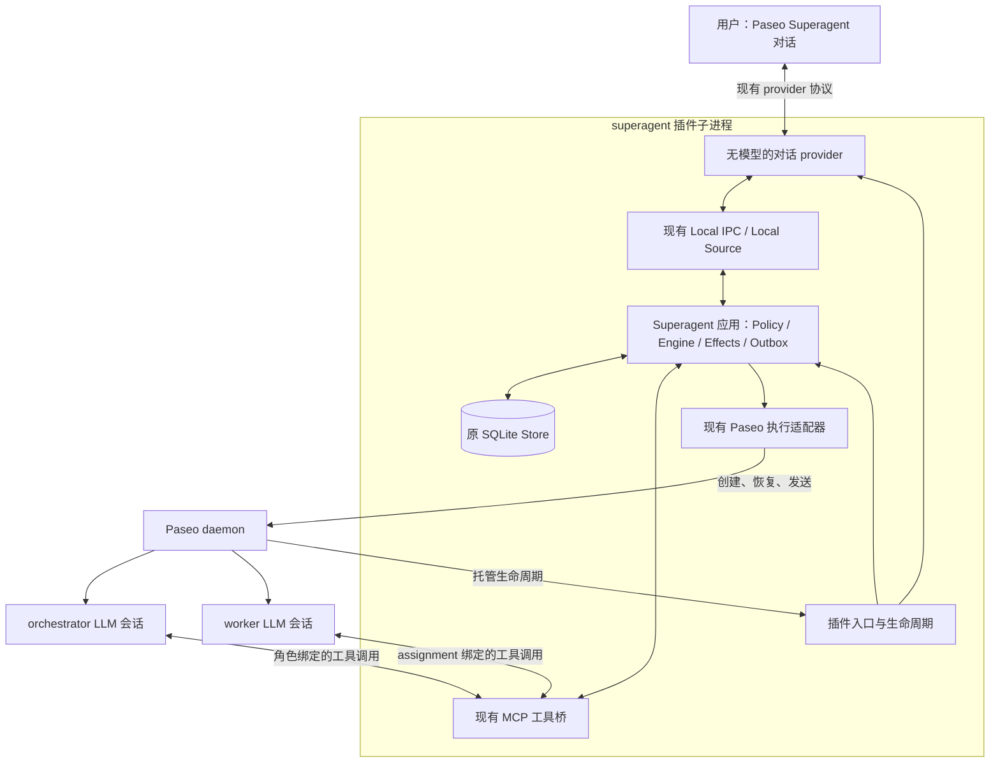

# 将 Superagent 控制面托管为 Paseo 插件

日期：2026-11-08。状态：设计与实现已完成，当前实例已迁移为 embedded；见 [实现计划](../plans/2026-11-08-paseo-plugin-host.md) 与 [验收记录](../plans/2026-11-08-paseo-plugin-host-validation.md)。下文的“当前耦合”描述设计前基线，实际实现以验收记录和源码为准。

基线：当前 `codex/paseo-integration` 工作树，包括已有的对话 provider、Paseo 执行适配及 worker 父会话绑定修改。官方接口按本机 daemon 的 **Paseo v0.15.2** 核查；仓库插件类型依赖目前为 `@getpaseo/plugin@0.14.0`，执行适配依赖为 `@getpaseo/client@0.8.0`。本设计不默认升级这些依赖。

## 1. 目标与结论

用户希望沿用 DeepSeek 官方 prototype 和现有适配，在 Paseo 中直接使用 Superagent，并由 Paseo 插件负责运行生命周期，不再手工保持一个 DSH 进程在线。继续以本地工具为主，沿用既有状态和会话，不启用 GitHub/飞书监听。

推荐：**扩展已有的 `superagent` 插件，让它同时注册对话 provider，并托管一个 Superagent 控制面实例。** 控制面使用 Paseo 已经为服务端插件创建的独立 Node 子进程，不另起 DSH，也不额外建立一个长期运行的 Node 守护服务。

与现有入口设计是同一个方向，但有一个明确的责任区分：

- provider 仍只收发消息、保存输入恢复信息和展示回复，不调用 LLM、不决定派工。
- 插件的服务端生命周期另外负责启动、停止控制面；它不是某个对话 session 的生命周期。
- Engine、Policy、Ticket、Store、Effects、Outbox 继续维护业务事实。
- 现有 Paseo orchestrator 调用模型进行理解、路由和组织；worker 调用各自 provider/model 执行实际任务。

这是把运行宿主从 DSH 换到 Paseo 插件。Paseo daemon 仍需在线；关闭客户端窗口不应停止控制面或任务。

本轮只重新打开早期设计中的“解除 DSH 宿主依赖”这一项，不恢复当时暂缓的交付接受状态机、通用调度平台或多项目管理。原型现有 `ready` 等业务语义继续沿用。

## 2. 调研依据

### Paseo 的官方能力

| 已核实事实 | 对设计的约束或支持 |
| --- | --- |
| `index.server.ts` 运行在 daemon 创建的独立 Node 子进程，拥有 Node 文件、进程和网络能力 | 可以运行 SQLite、定时循环、Unix socket 和现有 MCP 工具桥，不需要在 daemon 主进程里嵌入控制面 |
| contribution 必须同步返回 cleanup 函数，cleanup 可以异步 | 先注册 provider、返回清理函数，再异步启动控制面；不能直接把入口改为返回 Promise 的 async 函数 |
| 插件启动有 30 秒初始化超时 | GitHub 探测、锁等待和 orchestrator 恢复不能阻塞插件的注册完成 |
| stop 先发 shutdown，约 2 秒后发 SIGTERM，再约 2 秒后发 SIGKILL | 现有无界等待的 `Runtime.stop()` 不能直接作为插件 cleanup；必须限时清理并支持意外终止后的恢复 |
| 插件开始 shutdown 时会并发 dispose 内置 Paseo API | cleanup 不能依赖 handler context 中的 API 一直可用；首版继续使用现有适配器自己持有的连接 |
| `PluginServerContext` 注册 provider、RPC、settings、hooks，但没有可在 contribution 顶层直接读取的 `server.paseo` | 不设计不存在的 API；继续复用当前 `createPaseoAdapter()`，暂不迁移执行 SDK |
| provider 的连接和 session 有各自的关闭/空闲回收语义 | 关闭一个聊天或回收一个 provider session，只关闭它的订阅，不能关闭全局控制面 |
| 插件崩溃/重载失败会显示 failed，不承诺自动恢复旧插件 | 控制面启动失败要暴露具体错误；不能把“由 daemon 托管”写成自动高可用 |

设计阶段的本机只读能力检查：daemon 报告版本 `0.15.2`，插件 `superagent` 已安装且 running。用 daemon 报告的同一运行程序单独执行能力检查，得到 Node `24.20.0`，`require('node:sqlite').DatabaseSync` 为函数。当时只验证了基础运行环境；后续已完成插件完整启动和真实任务验收，详见验收记录。

官方证据：

- [插件运行环境与清理契约](https://github.com/getpaseo/paseo/blob/v0.15.2/public-docs/plugins/reference.md#entry-point-and-cleanup)
- [Provider 协议与会话生命周期](https://github.com/getpaseo/paseo/blob/v0.15.2/public-docs/plugins/providers.md)
- [服务端 Context 与同步 contribution 类型](https://github.com/getpaseo/paseo/blob/v0.15.2/packages/plugin/src/server/contracts.ts)
- [插件子进程、初始化超时与强制退出](https://github.com/getpaseo/paseo/blob/v0.15.2/packages/server/src/server/plugins/runtime.ts)
- [初始化注册、API dispose 与 cleanup 顺序](https://github.com/getpaseo/paseo/blob/v0.15.2/packages/server/src/server/plugins/plugin-process.ts)
- [插件 bundle 加载方式](https://github.com/getpaseo/paseo/blob/v0.15.2/packages/server/src/server/plugins/bundle-evaluator.ts)

### 改造前仓库的实际耦合

改造前 `paseo-plugin/index.server.ts` 只调用 `createSuperagentProvider({ stateDir })`；后者访问 `<stateDir>/local-ipc/s`。socket、数据库和调度循环由 `src/app/runtime.ts` 创建，当时 Runtime 继承 Cordis `Service`，通过 `src/index.ts` 的 `apply(ctx, config)` 启动。

需要拆分的耦合不止一个入口函数：

| 位置 | 现有依赖 | 必要改动 |
| --- | --- | --- |
| `src/app/runtime.ts`、`src/index.ts` | Cordis Service、服务注册、ctx 生命周期、logger、重启 | 提取普通应用生命周期，DSH 入口成为薄适配层，Paseo 插件调用同一应用 |
| `src/app/setup.ts`、`src/infra/environment.ts` | `ctx.subprocess`、运行环境验证和环境变量应用 | 提供宿主无关的命令执行接口；保留取消、超时、输出上限与原有凭据过滤行为 |
| `src/deployment.ts` | 部署解析与 Schemastery/volatile 配置在同一模块 | 分离普通配置/解析与 DSH 配置 schema；插件加载路径不能求值 Schemastery |
| `src/app/settings.ts`、`src/app/role-models.ts` | 默认模型验证通过静态导入关联 DSH LLM 实现 | 模型验证由宿主注入；Paseo 仍使用既有角色配置，不调用 DSH 模型注册表 |
| `src/app/runtime.ts` 的执行分支 | 同一文件直接导入原生 Sessions、DshExecutor | 把具体后端组装放在宿主入口，公共应用只接收必要接口，避免条件分支仍带入 DSH 运行时 |
| `src/executor/dsh.ts`、`src/paseo/sessions.ts` | 共享指令、任务路径、输入转换及 prepare 方法放在 DSH executor 内 | 将实际复用的辅助函数移到公共模块，避免 Paseo 入口绕回原生执行实现 |
| `src/app/http.ts` | 强制依赖 `ctx.webServer` 注册管理路由 | HTTP 注册成为可选宿主能力；DSH 保留原面板，插件首版用现有本地 status/日志诊断，不搬整套 DSH UI |
| `Runtime.shutdown()` | `ctx.agents`、`sessionPersistence.flush()`，以及无界 drain | 原生清理归 DSH 适配层；插件采用有截止时间、可恢复的停机流程 |
| `src/infra/paths.ts`、提示词/skill 加载、构建配置 | 以原生 ESM `import.meta.url` 查找包资源 | 独立 ESM 宿主产物保持正常 Node 模块定位，不能把它直接揉进 eval 执行的插件 bundle 后继续假设路径有效 |

`src/core` 的领域状态机不需要为了换宿主重写。LocalConversation、Paseo 执行与持久化操作记录也继续复用，但必须检查完整导入图，不能仅凭某个目录没有 `@deepseek-ai/*` import 就宣称已经脱离 DSH。

## 3. 方案比较

| 方案 | 代价与效果 | 选择 |
| --- | --- | --- |
| 在现有插件子进程内加载独立的 Superagent 宿主库 | 需要拆开上述宿主耦合；不增加第三个常驻进程，界面和生命周期统一 | 推荐 |
| 薄插件自动启动原来的 `dsh --profile ...` | 表面改动最少，但仍依赖 DSH、profile 和其生命周期 | 不作为目标方案 |
| 插件再启动独立 Node host 子进程 | 同样需要去掉 DSH 耦合；再增加进程监管、退出与通信边界 | 只有实际插件运行限制阻止第一种方案时才考虑 |

选择第一种，最小化的是**改造范围和语义变化**。它不会只有改入口的几行代码，但应避免改领域模型、重写调度或迁移执行 SDK。

## 4. 推荐结构与消息流

Local IPC 即使搬进同一插件进程也先保留。这样 CLI、provider、请求去重、会话恢复、访问权限和协议测试都可继续使用，不必同时改消息通路。模型的 MCP stdio bridge 仍通过另一条私有 socket 访问原工具；它不因为 provider 与控制面同进程就失去角色/assignment 校验。

一个插件实例只托管一个配置好的 `stateDir` 和一个控制面。多个窗口/对话连接共享它，不为每个 provider session 新建 Runtime、数据库或 orchestrator。worker 继续按 Ticket 创建，使用已有 `parent`、绑定和工作目录逻辑。

当前前台对话与 orchestrator 是不同角色；本轮不将二者合并。前台接收真实用户请求，控制面按 Policy 接纳，orchestrator 决定派工，worker 执行；回复经原 Outbox 回到前台。

## 5. 最小实现边界

### 公共应用与两个宿主入口

保留一个公共组装与生命周期实现。把 Cordis 注册、原生会话实现和原生清理移到 DSH 入口，新增一个只装配 Paseo 后端的入口。公共依赖仅按现有调用需要提取，例如 logger、配置、命令执行、会话/执行器工厂、可选管理接口挂载及宿主清理函数；不仿造整个 `ctx`，也不新增通用插件容器。

同一仓库继续支持两条入口：

- DSH `apply(ctx, config)`：注册原服务、原生模式所需钩子和现有管理 HTTP；仍可选择既有 Paseo 执行模式。
- Paseo 插件宿主入口：普通 Node 模块，装配 Paseo 会话/执行器、本地入口与工具桥；其运行依赖图不包含 Cordis/DSH 实现。

DSH 依赖可以留在开发仓库和兼容入口中。验收关注的是新宿主产物是否能够在不加载、不启动 DSH 的条件下运行，不能用删除旧文件来证明解耦。

### 插件启动与配置

`contribute()` 同步注册 provider、启动一个可观测的异步初始化任务，并返回 cleanup。应用状态区分 `starting`、`needs_setup`、`ready`、`stopping`、`error`；插件 running 仅说明插件注册成功，不等于控制面已经 ready。

初始化顺序：校验配置和 Node 能力 → 取得状态目录锁 → 打开原 Store → 启动本地诊断/入口 → 检查 deployment → 启动工具桥 → 恢复绑定与未决操作 → 启动调度。恢复完成前不派新任务。启动失败要清理已取得的资源，保留可诊断原因，不能留下部分启动的后台循环。

首版配置仍来自服务端本地配置，不顺便增加设置面板：

- `stateDir`：沿用当前 `/Users/anxiaojie/.dsh/state/sa-paseo-check`；目录名不决定实际宿主，不在本次迁移时改名。
- Paseo 地址、orchestrator/worker 的 provider/model、mode、bridgeCommand：沿用当前 profile 的实际值，移入宿主配置；保留显式模式，不提高权限。
- 临时的 `hostMode: external | embedded`：迁移前维持 external，完成停机交接后改 embedded；配置错误或锁被占用时不能自动切到另一模式。
- `runtimeEntry`：本地生成的独立 ESM 宿主入口的绝对路径，配置在服务端；不用 daemon 的 cwd 猜测项目路径。

已有 SQLite 中的任务、Policy、source 配置、会话映射、桥接授权和消息恢复记录原样沿用。首版承诺迁移当前已配置实例；全新实例的图形化初始化不在本轮。空状态或不完整配置应明确显示 needs_setup。

**去掉 DSH 进程不自动去掉原型的 GitHub setup 条件。** 当前 setup 即使仅接收本地请求，也检查仓库和 agent CLI；本轮先沿用当前已配置 deployment。改成完全不需要 GitHub 账号的通用本地工具是另一个行为变化。

### 资源与构建

建议增加 `lib/paseo-host.js` 独立入口，以及对应导出路径。插件服务端通过绝对文件 URL 动态导入该 ESM 文件，仍在同一个插件子进程中运行；不导入默认 `lib/index.js`，后者是 DSH 插件入口。

这个本地部署方式让原生 Node 模块负责 `import.meta.url` 和依赖解析，继续定位同一包中的 prompts、skills 和 MCP 入口。构建验收必须覆盖这些资源，并确认动态加载没有被插件二次编译改写成错误的资源定位。暂不设计插件市场分发、独立发布包或仓库迁移。

### 停机、异常与恢复

应用不能等待所有任务自然完成才允许卸载。以正常 cleanup 在约 1 秒内完成为目标，为 Paseo 的外层强制终止留余量；这不是操作系统调度下的时间保证。

1. 先阻止新请求接纳和新派工，持久记录本次宿主退出及仍需对账的操作；不把 Ticket 改成 completed，也不把插件重载解释成用户取消。
2. 取消宿主自己的网络/命令工作，关闭入口监听，对确认属于本实例的活跃会话发出限时中断请求。后台 jobs/subagents 是否停止仍沿用已有不确定性说明。
3. 短时间等待正在写库的应用操作退出。只有这些操作已静默，才关闭 SQLite，随后释放目录锁。释放顺序与当前约束一致。
4. 若期限内仍不能安全关闭，不提前释放锁，也不让旧异步回调写入已关闭的 Store；允许 Paseo 终止插件进程。重启端按锁协议等待旧拥有者退出/锁过期，不强删活锁。
5. 重启后先恢复桥、会话绑定、消息回执及操作 journal，再进行对账。创建/发送结果不明时，沿用已有证据匹配和不明结果处理，不能盲目重发或重建 worker。恢复不能完成时保持阻塞并报告原因。

正常重载和意外崩溃都需要覆盖。保留现有“写前意图 + 对账”的保证范围，不声称外部副作用在任何故障下都严格只发生一次。模型在控制面失联期间可能仍运行；恢复后不能只看 idle 就推断任务已完成或所有子进程已停止。

首版保留当前适配器自己的 Paseo 连接，使清理不依赖已开始 dispose 的插件 handler API。需要等待的执行调用必须支持取消/截止时间，不能用超时 Promise 包住无限等待后立即关闭数据库。

## 6. 迁移步骤与验收

以下是已采用的实现验证顺序，逐项实测结果见验收记录：

1. 从现有 Runtime 提取宿主依赖，先让 DSH 原入口继续通过现有检查，防止抽取改变业务行为。
2. 生成独立 Paseo 宿主产物，用隔离的测试状态目录验证启动、未配置状态、停止及缺少 DSH 运行依赖时的导入。
3. 扩展现有插件，验证同步注册、后台启动状态、provider 连接回收与全局宿主生命周期分离。
4. 做完整 A/B 追问、实际文件产出和结果回传演练，并在 create/send/report 的关键窗口测试重载或终止后的恢复。
5. 当前真实实例迁移时，先停止 DSH 并确认锁已释放，再备份一致的状态目录，将同一插件切换为 embedded 后重载。不得双写同一状态目录。

必须通过的验收：

- 进程中没有 DSH，仅 Paseo daemon、插件子进程和必要的实际 agent/MCP 进程；在 Paseo 窗口能完整执行任务。
- 不依靠 DSH 模块的实际运行依赖图，构建后的提示词、skills 和 MCP 命令路径都有效。
- 历史前台对话、Ticket、orchestrator/worker ID 与 workspace 绑定继续可用；新 worker 遵守已有父会话分组逻辑。
- 新任务接收、追问回复、ready 报告、前台投影遵守当前语义；同一消息重试不重复接收。
- 打开多个窗口、关闭窗口或空闲回收 provider session，不创建第二个控制面，也不停止全局控制面。
- 插件重载、启动失败、锁冲突、daemon 重启及强制终止可诊断；未决 create/send/report 可对账，不能静默重复执行。
- 子进程执行适配保留原凭据过滤、取消、输出限制和显式执行权限；输入 socket 与模型工具桥保持分离。
- GitHub/飞书 watcher 不会因为换宿主自动启用；原 DSH 路径的类型检查、测试和构建继续通过。

回滚时先停止 embedded 宿主，再将插件改为 external，使用同一状态目录启动既有 DSH profile。首版不主动升级数据库业务 schema；若实现确实需要不兼容变更，必须重新评估这条回滚方式。

## 7. 实际交付与范围

已交付公共宿主接口、DSH 兼容适配、独立 Paseo ESM 宿主、插件生命周期接管、停机与恢复验证，以及当前实例迁移和回滚演练。真实实例继续使用原状态目录、对话、协调者和 worker 绑定，GitHub/飞书 watcher 保持关闭。代码和文档留在原工作树，未推送。

全量检查为 75 个测试文件、1299 项测试通过，另有真实模型、Paseo 二次编译、桌面结果查看和独立 daemon 重启证据。daemon 重启仅在独立 v0.15.3 空配置实例验证；未重启生产 v0.15.2 daemon。插件崩溃后原对话可能需重开，宿主停止也不证明未知后台子进程全部终止。全新实例图形化 setup、插件市场分发和更强的外部副作用保证仍不在本轮范围。
