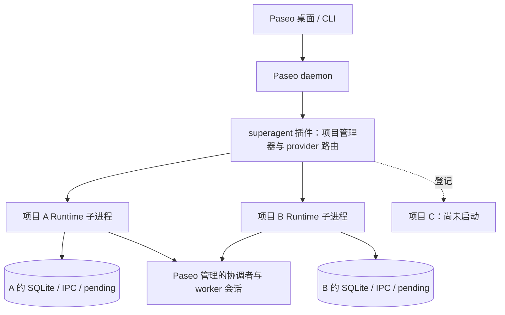

# Paseo 插件管理多个项目 Runtime

日期：2026-11-09。状态：规格与计划经用户确认后已实施；见 [实现计划](../plans/2026-11-09-paseo-multi-project-runtime.md) 与 [验收记录](../plans/2026-11-09-paseo-multi-project-runtime-validation.md)。日常实例已原地登记为 legacy。

基于现有仓库与 `codex/paseo-integration` 工作树。沿用已实现的 [Paseo 插件宿主](2026-11-08-paseo-plugin-host-design.md)，保留当前单实例及 flow-web 的未提交改动，不另建项目、不自动提交或推送。

## 1. 目标与已确认约束

用户希望在同一个 Paseo 中使用多个项目的 Superagent，并明确桌面应用退出、daemon 停止和项目空闲时各实例的行为。

本轮目标：

- 保留一个 `superagent` 插件和 provider，按项目路由。
- 每个项目独立 Runtime 子进程，复用现有单仓库应用。
- 各项目的数据库、Policy、对话、协调者、worker 绑定与命令环境独立。
- Runtime 生命周期归插件和 daemon；打开、关闭或切换聊天窗口不停止任务。
- 默认按需启动，提供明确的项目级启动、停止和状态入口；首版不自动回收空闲实例。
- 已启动项目可以在 daemon 重启后按持久化意图恢复；明确手动停止的项目保持停止。
- 现有实例作为第一个项目迁入，保持状态目录和会话身份连续。

本轮不增加多仓库总协调者、不改 `src/core` 的 Policy/Ticket/Assignment/完成语义，不升级执行 SDK，不开启 GitHub/飞书监听，不修改 Paseo 的桌面退出设置。

## 2. 当前实现与必须处理的耦合

| 当前事实 | 设计要求 |
| --- | --- |
| 插件入口创建唯一 host control，provider 固定指向一个 `stateDir` | 新增项目管理器与项目路由，单实例宿主继续复用 |
| `Setup` 通过 `applyEnvironment()` 修改进程级 PATH、git 和 shim 环境 | 插件管理进程不能直接构造多个 Runtime；每项目在独立子进程运行 |
| provider 的 `session.open` 已提供 `config.cwd`，当前只回显它 | 将 cwd 用于首次项目匹配，随后持久绑定项目身份 |
| 每个项目数据库已有一个 `conversation-binding` | 保留每项目一个持久对话；本轮不同时引入每聊天独立 conversation |
| 现有 pending 输入位于该实例的 `paseo-ui-pending` | 路由后使用对应项目的 pending 文件，保持原请求身份和回执对账 |
| 现有协调者/worker agent 的配置已冻结 | 不修改历史 agent 的 cwd、模型、工具授权或 parent |
| flow-web 是项目宿主拥有的可选本地 HTTP 读取服务 | 保留项目所有权，避免不同项目抢占同一端口 |

关键源码：[进程环境](../../../src/infra/environment.ts)、[现有入口](../../../paseo-plugin/index.server.ts)、[provider 连接](../../../src/paseo-ui/connection.ts)、[持久对话](../../../src/local/conversation.ts)。

## 3. 方案选择与进程边界

| 方案 | 代价 | 结论 |
| --- | --- | --- |
| 一个插件进程内运行多个 Runtime 对象 | 必须消除所有进程环境共享和清理相互覆盖，还要重新审查第三方依赖 | 暂缓 |
| 一个插件管理器，每个项目独立 Node 子进程 | 增加窄启动/状态协议和进程监管；原单项目应用继续复用 | 采用 |
| 另建独立于 Paseo daemon 的后台服务 | 增加安装、守护和连接恢复；当前任务执行仍依赖 Paseo daemon | 暂缓 |



管理器负责登记、绑定、启停、状态和日志转发，不调用模型、不接管业务调度、不打开各项目 SQLite。协调者与 worker 会话仍由同一个 Paseo daemon 执行；它们不是 Runtime 子进程的普通 OS 子进程。

项目进程只加载普通 ESM 宿主入口并调用 `createPaseoHost()`，不加载 DSH/Cordis 实现。管理器及 provider 的 bundle 不能通过值导入把 Runtime 或 SQLite 带进管理进程。

## 4. 项目登记与身份

### 登记表

日常入口不再要求用户编辑 TypeScript：首次在新 Paseo workspace 发起 Superagent 对话时，管理器自动创建项目并持久化到 `<managerDir>/projects.json`。`local-config.ts` 的静态 `projects` 只保留为高级覆盖（固定 id、aliases、指定 stateDir、提前禁用），并可用 `autoRegister: false` 关闭自动登记。auto 项目使用 `auto-<目录名>-<路径哈希>` 作为初始稳定 id，stateDir 默认位于 managerDir 同级的 `superagent-projects/<id>`，flow-web 默认关闭。项目记录包含：

| 字段 | 含义 |
| --- | --- |
| `id` | 显式、稳定的项目 ID；不以当前 cwd 或路径哈希充当永久身份 |
| `label` | 面向用户的名称 |
| `root` | 实际受管项目的绝对根目录 |
| `aliases` | 明确归入该项目的其他根目录，例如 Git worktree |
| `enabled` | 是否允许使用该项目 |
| `hostConfig` | 现有 HostConfig，含该项目独立的 stateDir、模型、桥接路径和可选 flow-web |

管理器另有独立的绝对 `managerDir`，存放项目运行意图、管理 socket、锁和有界日志。该目录不存第二套 Ticket/Policy/对话历史。shared 配置继续保持纯数据，类型校验归入口和独立声明文件，兼容 Paseo 二次编译。

规则：

1. 验证项目 ID 唯一；对现存 root、aliases、stateDir 做 realpath/所有者/权限检查，拒绝两个项目共享同一真实状态目录。
2. 新对话以 cwd 的真实路径匹配 root/aliases；必须按路径组件判断包含关系。若登记了嵌套项目，优先最长根目录；同等精度冲突视为配置错误。
3. Git worktree 首版显式登记为 alias。不同 clone、同名目录、相同远端 URL 不自动合并。
4. root 或 stateDir 缺失、绑定歧义时报告具体错误，不默认为第一个项目；不根据消息文本猜项目。
5. 项目目录移动通过更新登记关系保持原 id。插件代码目录不自动等于受管项目目录。
6. `SUPERAGENT_STATE_DIR` 只保留单实例兼容语义；多项目模式拒绝该全局覆盖，避免把所有项目指向同一目录。
7. 自动登记只继承模板项目的运行参数（Paseo URL、模型、桥接路径、限额），不复制账号、Policy、Tool grant、Ticket 或数据库；新 stateDir 仍走原型 setup，未配置时进入 needs_setup。
8. 同一真实路径的并发首次打开合并为一次登记；`projects.json` 采用 0600 权限和原子写入，重载插件与 daemon 重启后恢复。

新项目继续接受原型的 deployment/setup 检查。登记目录不等于已完成仓库和账号配置；空状态进入 needs_setup，并说明缺少项。本轮不自动复制现有项目的账号、Policy、tool grant 或数据库，不新增无 GitHub 初始化流程。

### 状态目录与 workspace

项目 root、Runtime stateDir、Ticket 执行目录是三种不同概念。新项目可以让新建的协调者及 worker 归入对应项目的 Paseo workspace，Ticket 仍使用自己的任务目录；历史 agent 保持既有 cwd/parent。

为此允许宿主显式给出新建协调者的 workspace 目录，缺省沿用旧 stateDir 行为。这个宿主配置只影响新建会话，不改冻结绑定，也不把数据库搬到项目 checkout。

## 5. 对话路由与兼容恢复

provider 仍只有一个 `superagent` 注册项：

1. 首次 `session.open` 按 config.cwd 查找项目，按需启动该项目。
2. 在进入真实 provider 会话前，检查项目 ready/needs_setup/error。入口等待启动最多 5 秒；超过时报告“项目正在启动”，后台启动可继续，但不显示已接单、不持久化尚未提交的输入。
3. 使用对应项目的现有 transport、pending 和 conversation connection。
4. 新 provider persistence 使用版本 2，数据包含稳定 `projectId` 和原版本 1 的 `ConversationBinding`。
5. 恢复会话优先使用持久 projectId；cwd 改变不能把旧对话转给另一项目。项目被移除或禁用时报告不可用。
6. 管理器校验项目与 conversation binding 一致后，才允许读取历史或提交输入。

项目身份只进入外层 provider persistence 和登记表，不改变核心 ConversationInput、消息 requestId 算法或 Ticket schema。每项目一个数据库、一个既有 conversation；同项目多窗口仍是同一对话的视图。

路由连接维护 `sessionId → projectId` 映射。所有 prompt/interrupt/close 都沿用该映射，不能在每条消息到来时重新查看当前 UI 项目。关闭一个连接只释放该连接持有的订阅。

版本 1 的历史 persistence 仅通过明确配置的 `legacyProjectId` 恢复：启动该项目后从它的 IPC 读取已有 binding，完全匹配后才接受，并升级外层 persistence。不能把所有不认识的旧会话或 cwd 都指向 legacy 项目。

输入/恢复失败沿用原 pending 与 receipt 语义。同一个 clientMessageId 在不同项目各自处理；不把 A 的 pending 搬到 B，也不因重启给同一输入生成新身份。

## 6. 按需启动与项目级控制

### 进程监管

- 插件 contribution 同步注册 provider 与管理入口，不等待所有项目启动。
- 同一项目的并发启动合并为一个 Promise；不同项目可以并行启动。
- 显式使用已验证的 Node 可执行文件运行子进程入口，配置通过私有 IPC 传入，不在 argv、日志或父进程环境中展开凭据。
- 子进程使用独立且经过过滤的环境，复用现有 Node runner 的凭据过滤原则；Runtime 的进程级环境变更只发生在该子进程中。
- 状态消息绑定项目 id、启动 generation 和确切 ChildProcess；迟到的旧 ready/exit 不能覆盖新实例。
- 仅在旧子进程真实 close 且所有权条件满足后，允许启动后继实例。stop 的 deadline 不构成可重启证据。
- 启动失败要收敛已创建资源；一个项目错误不停止其他项目。

首版不因空闲、窗口关闭或等待用户回答回收进程。仅登记且未用过的项目不启动；已经启动的项目持续运行到显式停止、插件停止或 daemon 停止。

### 控制入口与运行意图

提供独立的薄 CLI，例如：

```text
superagent-project --manager-dir /absolute/manager list
superagent-project --manager-dir /absolute/manager status PROJECT_ID
superagent-project --manager-dir /absolute/manager start PROJECT_ID
superagent-project --manager-dir /absolute/manager stop PROJECT_ID
superagent-project --manager-dir /absolute/manager restart PROJECT_ID
```

CLI 通过 owner-only 管理 socket 调用插件管理器，不直接操作项目数据库，不启动独立常驻服务。保留现有 `superagent-local --state-dir ...` 的协议和行为。

管理器持久化每项目的操作意图与恢复标记，使用独占管理锁和原子文件写入：

- 登记后未使用：允许按需启动，不在 daemon 启动时全部拉起。
- 明确启动/首次使用成功：登记为下次启动需恢复。
- 明确手动停止：登记 stopped，取消自动恢复；打开旧对话也不自动撤销它。
- daemon 或插件正常停止：保留运行意图，不等同于用户手动停项目。
- 重启：只恢复允许恢复且此前已启用运行的项目；配置 disabled 和手动 stopped 的项目不启动。

运行意图与实际状态分开。`starting/ready/needs_setup/stopping/stopped/error` 继续表示宿主状态，不新增核心任务状态机。首版不为不同项目另做全局 LLM 调度或公平性系统；沿用各项目 maxWorkers，并在验收时记录多实例实际进程/资源开销。

## 7. daemon、桌面应用与退出

按核查的 Paseo v0.15.3：

- macOS 的关闭全部窗口不会直接执行 app.quit。
- 桌面退出时，`daemon.keepRunningAfterQuit` 决定是否停止桌面自己托管的 daemon；源码默认值为 false。
- 外部独立启动或远端 daemon 的所有权不同，不能一概视为桌面退出就停止。
- 插件收到 shutdown 后仅有短 cleanup 窗口，随后可能被 SIGTERM/SIGKILL。

证据：[桌面退出逻辑](https://github.com/getpaseo/paseo/blob/v0.15.3/packages/desktop/src/daemon/quit-lifecycle.ts)、[默认配置](https://github.com/getpaseo/paseo/blob/v0.15.3/packages/desktop/src/settings/desktop-settings.ts)、[macOS 窗口生命周期](https://github.com/getpaseo/paseo/blob/v0.15.3/packages/desktop/src/main.ts)、[插件进程停止](https://github.com/getpaseo/paseo/blob/v0.15.3/packages/server/src/server/plugins/runtime.ts)。

| 事件 | Runtime 行为 |
| --- | --- |
| 切换项目、关闭对话或 provider 连接 | 不停止项目，不改变其恢复意图 |
| 关闭桌面窗口，但 daemon 在线 | 继续执行 |
| 退出桌面且 daemon 保持运行 | 继续执行 |
| 退出桌面并停止其托管 daemon | 所有项目启动统一停机 |
| daemon stop/restart、插件 disable/reload | 停止接收新启动/输入，并行收敛各项目，保留恢复意图 |
| 单个项目手动 stop | 只停该项目，持久记录手动停止 |
| 项目子进程崩溃 | 只将该项目标为 error；首版不无限自动重启；显式 start 可在锁/对账条件满足后恢复 |
| 插件/daemon 异常退出 | 项目进程检测 IPC 断开并退出；继任者等待旧锁和对账，不强抢 |

不修改用户 keepRunningAfterQuit 设置。使用说明解释两种选择：保持后台 daemon 以持续执行，或者退出时停机、下次恢复。

### 有界停机与所有权

1. 管理器进入 stopping，拒绝新 spawn/输入，固定本次需停止的子进程集合。
2. 同时向所有项目发送 stop，使用一个约 1 秒的插件 cleanup 等待预算，不逐个累计等待。
3. 每个 Runtime 沿用已有清理：冻结派工、取消宿主工作、尝试中断确实属于本实例的会话，等待已进入的 effect/IPC 工作收敛，再关闭 SQLite 和释放锁。
4. 预算内未完成时报告 deadline，保留写入所有权。管理器只对自己实际创建且仍确认归属的子进程发信号，不使用全局进程名匹配。
5. 若管理器被强制终止，子进程的 IPC disconnect/SIGTERM 处理启动同一清理流程并设有限退出期限。无法安全完成时进程终止，锁按原 30 秒 stale 协议交接，不能主动删除未确认失效的锁。
6. 不能因为管理器消失便断定旧进程已消失。同步卡死、强制杀进程等极端情况必须通过所有权检查阻止双写，并暴露旧 owner 阻塞信息。

项目进程退出不表示 Paseo 上所有会话与未知后台子进程已结束。特别是 daemon 正在停止时，中断 API 可能不可达；保持原有未知结果说明，不保证任何故障下都无残留外部操作。

## 8. 恢复、兼容与已有功能

重新启动项目时继续加载原 stateDir；先恢复 bridge、绑定、回执与 journal，对账后再派工。无法确认的 create/send 不自动重发，宿主停机不将 Ticket 改成 completed 或用户 cancelled。

迁移顺序：

1. 记录当前实际受管仓库、原 stateDir、conversation/master/agent/workspace 身份、Ticket 与外部 watcher 状态。
2. 在隔离状态与独立插件/daemon 验收多项目，再处理日常实例。
3. 登记 legacy 项目，保持 `/Users/anxiaojie/.dsh/state/sa-paseo-check` 和当前部署配置，显式配置旧会话兼容映射。
4. 停旧 embedded 宿主并确认所有权释放，取得一致备份；切为管理器模式，由项目子进程打开同一状态。
5. 验证旧会话恢复、历史读取和新任务回传，确认旧模型、Policy、tool grant 与 agent 身份没有被重建或复制。
6. 回滚时先停管理器及其项目子进程，再恢复单实例入口；继续用原数据库，不以旧备份覆盖新任务。

原 external/embedded 单实例配置继续支持。登记表存在时显式选择管理器模式；互相冲突的旧/新配置报错，不静默混用。

flow-web 继续归各项目 Runtime：现有项目保留已配置端口；新项目默认不启用。启用多个项目画布时必须配置不同端口，配置校验拒绝冲突。本轮不新增聚合跨项目画布。

GitHub/飞书 watchers 保持关闭。未来启用时须增加明确入口归属与常驻/唤醒设计，本轮不声称停机期间仍能实时处理外部消息。

## 9. 实现落点与验收

预期的最小模块边界，具体任务拆分在规格确认后的实现计划确定：

| 边界 | 责任 |
| --- | --- |
| 项目登记解析 | 配置校验、canonical path 匹配、稳定项目 ID、冲突拒绝 |
| 项目管理器 | 单项目启动合并、独立子进程、generation、运行意图、并行停机 |
| 子进程入口/协议 | 普通 ESM 宿主加载、ready/status/stop、父连接断开、确切退出 |
| provider 项目路由 | session.open 的项目选择、v2 persistence、v1 兼容、多项目事件分发 |
| 管理 IPC/CLI | list/status/start/stop/restart，仅项目运行控制 |
| 现有宿主小扩展 | 新建会话的 workspace 目录配置、保留当前配置与 flow-web |

验收必须覆盖：

- 两个项目同时运行，进程 PID、环境/shim、SQLite、对话、协调者和 worker 绑定分别独立。
- 同项目并发打开只产生一个 Runtime；关闭任一前台连接不停止项目。
- A/B 都使用相同 clientMessageId 时不混输入/回执；A 的历史、pending、工具授权不出现在 B。
- 子目录、同名前缀、symlink、嵌套根目录、显式 worktree alias、未登记目录和重复 stateDir 的匹配结果明确。
- 旧 v1 会话仅恢复到配置的 legacy 项目；修改 cwd、重连、跨项目伪造 persistence 不改变绑定。
- 冷启动超时、needs_setup、初始化失败不显示已接单，不构造第二个运行实例。
- 项目 start/stop/restart 与停止中的迟到 ready/exit 无竞态；启动中 cleanup 不会在停止后留下新实例。
- 单项目崩溃不影响另一项目；管理器退出/强制终止后可诊断并按锁协议恢复。
- 多个项目并行 cleanup 遵守一个总预算；旧工作未结束时新实例不能取得同目录所有权。
- daemon 正常重启恢复此前运行项目，手动停止和从未启动项目保持停止；不改写 Ticket 业务结束状态。
- 桌面窗口关闭继续执行；退出后的结果按 keepRunningAfterQuit 和实际 daemon 所有权分别验证。
- 两个项目的 flow-web 配置不抢端口；现有画布继续读取所属 Store，并随所属 Runtime 关闭。
- 原 DSH/external/embedded 路径、独立宿主无 DSH 运行依赖的构建测试继续通过。
- 使用隔离环境做真实 A/B 任务和结果回传、插件 reload、daemon restart、手动停项目及恢复；日常实例迁移前后身份摘要一致。

仅文档阶段不运行真实 daemon 停机，不改生产配置。实现完成时运行对应定向测试、`pnpm check` 与 `git diff --check`，把实测范围和任何未验证项另写验收记录。

## 10. 规格自查

- 用户已确认的方向全部对应到项目登记、子进程隔离、持久对话绑定、daemon 生命周期和按需启动；没有把每个聊天当作一个项目。
- 保持原型单项目内核；管理器只拥有运行意图，不新增业务数据库或全局 LLM。
- 空闲回收、跨项目协调和外部监听唤醒明确延后，避免第一版同时修改调度/权限/接收语义。
- 当前环境全局变量、旧 persistence、启动耗时、短 cleanup 预算、父进程异常退出及画布端口均有明确处置和验收项。
- 现有实例的迁移与回滚都以原目录及锁交接为前提，不能复制身份或覆盖迁移后的数据。
- 已交付 managed 模式、独立项目进程、持久化路由/运行意图和管理 CLI，保留旧宿主与画布；完整测试为 84 个文件、1334 项通过。已有实例迁移及回滚往返、隔离双项目真实任务与控制 daemon 重启已验证。未退出日常桌面或重启日常 daemon；具体范围和差异以验收记录为准。
